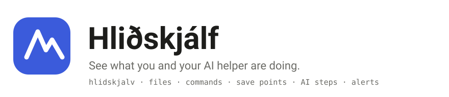
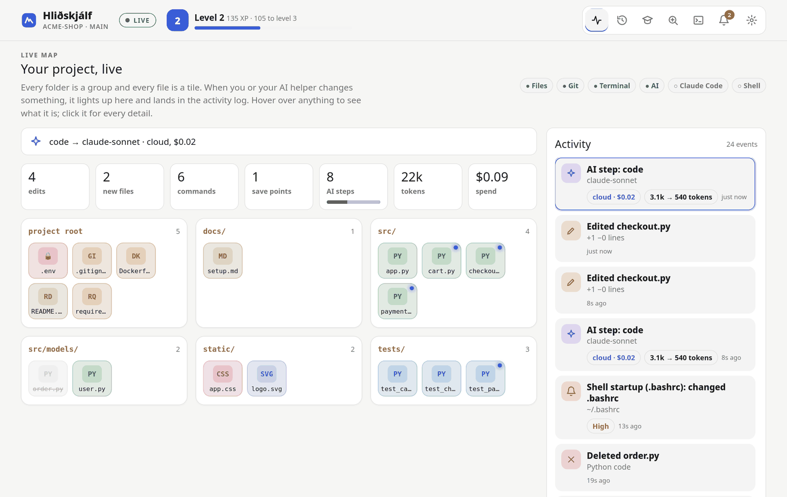
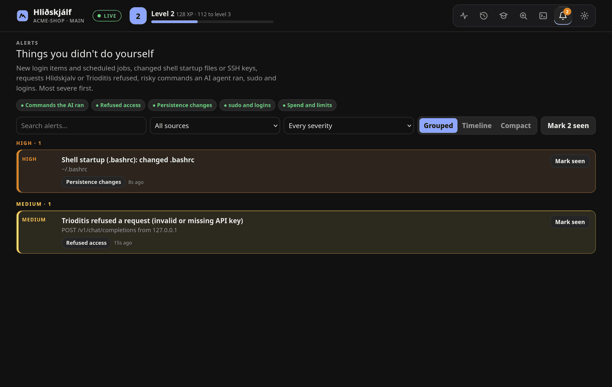
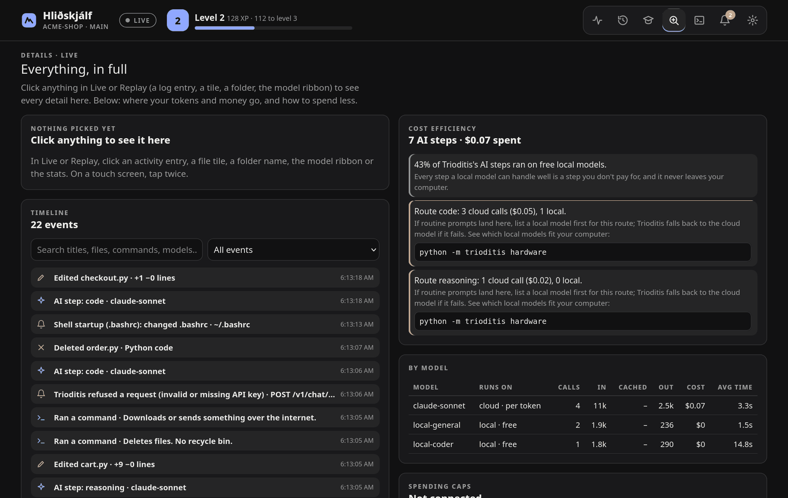

<div align="center">

<picture>
  <source media="(prefers-color-scheme: dark)" srcset="docs/img/banner-dark.svg">
  
</picture>

**A live, plain-English map of your project and everything your AI coding helper does in it.** Hlidskjalv watches one folder: every edit, command, Git save point and AI step lights up and lands in an activity log, and anything you did not do yourself raises an alert. Hover over anything for an explanation.

[](https://github.com/alexb-joat/hlidskjalv/actions/workflows/ci.yml)
[](https://github.com/alexb-joat/hlidskjalv/actions/workflows/codeql.yml)


[](LICENSE)

[Start](#start-in-2-minutes) &nbsp;·&nbsp; [What you get](#what-you-get) &nbsp;·&nbsp; [Privacy](#privacy-and-security) &nbsp;·&nbsp; [Docs](#documentation)

<sub><i>Hlidskjalv: Odin's high seat, from which he looks out over every realm and sees all that happens.<br>Here it looks out over one project.</i></sub>

</div>

<br>

<picture>
  <source media="(prefers-color-scheme: dark)" srcset="docs/img/live-dark.png">
  
</picture>

<sub>The Live view on a sample project: files as tiles, glowing dots for what changed this session, and the activity log with an AI step, a startup-file alert and a refused request. Made for people who are new to coding and work with an AI helper in VS Code.</sub>

## What you get

| View | What it does |
|---|---|
| **Live** | A live map of the project and an activity log of everything that happens, with "Careful" badges on risky commands |
| **Replay** | Every session is saved on your computer; scrub through it step by step |
| **Learn** | Five short levels (terminal, Python, Git, working with AI, Trioditis), a command decoder and badges |
| **Details** | Click anything for every detail: why a model was picked, tokens, cost, what each piece of a command does. Plus where your tokens and money go, and how to spend less |
| **Terminal** | Optional: a real shell in the project folder, inside the page (off unless you start with `--terminal`) |
| **Alerts** | Things you didn't do yourself: risky commands an AI ran, login items and startup files that changed, refused requests, spending caps, `sudo` and logins |

<table>
<tr>
<td width="50%"><br><sub><b>Alerts.</b> A changed startup file and a refused request, most severe first.</sub></td>
<td width="50%"><br><sub><b>Details.</b> Where tokens and money go, per model and per route.</sub></td>
</tr>
</table>

Hlidskjalv only **watches**: it never changes your files and never runs anything from your project. The one exception is the optional terminal, which you switch on yourself.

## Start in 2 minutes

You need Python 3.10 or newer (on Windows, install it from [python.org](https://www.python.org/downloads/) and tick "Add python.exe to PATH").

```bash
git clone https://github.com/alexb-joat/hlidskjalv.git && cd hlidskjalv
python3 -m hlidskjalv watch ~/projects/my-app
```

On Windows use `py -3 -m hlidskjalv watch C:\Users\you\projects\my-app`.

Your browser opens at `http://127.0.0.1:8788`. Leave the terminal running while you work; **Ctrl+C** stops it and saves the session for Replay. Point it at **one project folder**, not your whole home folder or drive (it refuses those).

Prefer a command on your PATH? Run `pip install .` (or `pipx install .`) in the clone, then `hlidskjalv watch ~/projects/my-app`. Nothing else is downloaded: there are no dependencies.

## See your terminal commands (optional)

A small hook records commands typed in the project, by you or by your AI helper in VS Code's terminal, into the activity log:

```bash
python3 -m hlidskjalv hook bash >> ~/.bashrc          # macOS (zsh): hook zsh >> ~/.zshrc
```

<details>
<summary>Windows (PowerShell), what is recorded, and how to remove it</summary>

```powershell
if (!(Test-Path $PROFILE)) { New-Item -Force $PROFILE | Out-Null }
py -3 -m hlidskjalv hook powershell | Add-Content $PROFILE
```

Open a new terminal afterwards. Commands are written to `~/.hlidskjalv/commands.log` (readable only by you). **Start a command with a space** to keep it out. Secrets that slip into commands (`API_KEY=…`, tokens, passwords in URLs) are masked before they are shown or saved. To remove the hook, delete the lines between `# --- Hlidskjalv` and `# --- end Hlidskjalv ---` in that file.

</details>

## Go further

| Topic | What it covers |
|---|---|
| **AI steps and cost** | Connect [Trioditis](https://github.com/alexb-joat/trioditis) or Claude Code and see which model handled each step, tokens, cost, caps and limits. [docs/ai-and-cost.md](docs/ai-and-cost.md) |
| **Alerts** | What raises an alert, and how to tune it. [docs/alerts.md](docs/alerts.md) |
| **Pairing** | Changing settings or opening the terminal needs a paired browser: one-time link, password, two-factor, GitHub or Google sign-in. [docs/pairing.md](docs/pairing.md) |
| **Terminal in the page** | A real shell, off by default and locked down when on. [docs/terminal.md](docs/terminal.md) |
| **Sync** | Settings, XP and Learn progress between your computers, encrypted, with no server. [docs/sync.md](docs/sync.md) |
| **Make it yours** | Palettes, a colour wheel, fonts, backgrounds, layout. [docs/customize.md](docs/customize.md) |
| **Start at login** | One command, and exactly what it installs. [docs/autostart.md](docs/autostart.md) |

Also from a terminal, without a browser: `python3 -m hlidskjalv status` prints plan windows, spend against caps, unread alerts and whether the services run.

## Privacy and security

- **Local only.** It listens on `127.0.0.1`, rejects any other `Host`, and only its own page may change anything.
- **File contents never leave a module.** Only names and line counts. Files that look secret (`.env`, `*.pem`, `id_rsa`, `*secret*`…) are not even read, and secrets in commands are masked.
- **Read-only.** It never executes project files; Git runs with hooks and fsmonitor off, so a cloned repo cannot make it run anything.
- **No unsafe script.** The page's script is a served file under `script-src 'self'`, so an injected inline script does not run.
- **Sessions** live in `~/.hlidskjalv/sessions` (owner-only); the last 50 are kept (`--keep` to change).

### Outbound connections

There is no server of its own and no telemetry. These are the only connections the page or program can make, each to a service you chose, and a default install makes none:

| Connection | When | What leaves your computer |
|---|---|---|
| Google Fonts (`fonts.googleapis.com`, `fonts.gstatic.com`) | Only when you pick one of the Google fonts in Settings, or press "Preview every font" | The font's name; Google sees your IP address, as with any web request |
| GitHub Gist (`api.github.com`) | Only after you set up [Sync](docs/sync.md) with a Gist | Your settings, XP and Learn progress, encrypted on your computer first |
| GitHub or Google sign-in | Only after you set up [sign-in](docs/pairing.md) | That you use Hlidskjalv, at each sign-in, via an OAuth app registered under your own name |

Report a vulnerability privately via [SECURITY.md](SECURITY.md). The design, its controls and its limits are in [docs/security-model.md](docs/security-model.md).

## Try it without installing

Open the page without a running Hlidskjalv and it shows a demo session with example data, so you can explore Live, Replay, Learn and Details and try the customization (kept in your browser).

## Documentation

[AI steps and cost](docs/ai-and-cost.md) · [Alerts](docs/alerts.md) · [Pairing](docs/pairing.md) · [Terminal](docs/terminal.md) · [Sync](docs/sync.md) · [Customize](docs/customize.md) · [Start at login](docs/autostart.md) · [Browsers and systems](docs/browsers-and-systems.md) · [Security model](docs/security-model.md)

Browsers: Chrome, Edge, Brave and Opera 111+, Firefox 113+, Safari 16.2+. The server runs on Linux, macOS and Windows 10 (1809)+ with Python 3.10+, and CI runs the whole suite on all three.

## Contributing

```bash
python3 -m unittest discover -s tests -t .
```

See [CONTRIBUTING.md](CONTRIBUTING.md) for the ground rules: no runtime dependencies, nothing outbound by default, no inline script.

## License

[MIT](LICENSE). Not affiliated with VS Code, Cline, Anthropic, OpenAI or Ollama.
