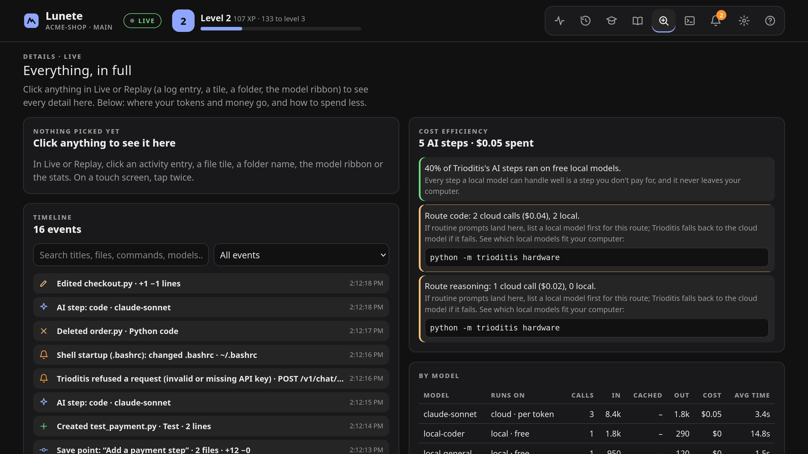
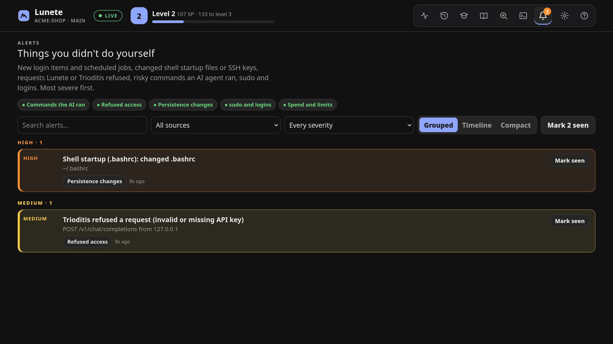

# Guide

Everything Hlidskjalv shows and how to tune it. Pairing and sync have [their own page](pairing-and-sync.md); how it's secured is in [Security](security.md).

[← Back to the README](../README.md)

[The views](#the-views) · [AI steps and cost](#ai-steps-and-cost) · [Alerts](#alerts) · [Your terminal commands](#your-terminal-commands) · [Terminal in the page](#terminal-in-the-page) · [Make it yours](#make-it-yours) · [Start at login](#start-at-login)

---

## The views

| View | What it does |
|---|---|
| **Live** | A live map of the project and an activity log of everything that happens, with "Careful" badges on risky commands |
| **Replay** | Every session is saved on your computer (`~/.hlidskjalv/sessions`, the last 50; `--keep` to change); scrub through it step by step |
| **Learn** | Short games, a command decoder and badges |
| **Details** | Click anything for every detail: why a model was picked, tokens, cost, what each piece of a command does. Plus where your tokens and money go |
| **Alerts** | Things you didn't do yourself (see [Alerts](#alerts)) |
| **Terminal** | Optional: a real shell in the project folder (see [Terminal in the page](#terminal-in-the-page)) |

Hover over anything for an explanation. **Help** (the question mark next to Settings) has the tour again, the keyboard shortcuts, what each view does and the command decoder. Open the page without a running Hlidskjalv and it shows a demo session with example data, so you can try every view and the customization (kept in your browser).

## AI steps and cost

Show which model handled each AI step, what it cost, and where your tokens and money go. Works with Trioditis and, read-only, with Claude Code's own transcripts.

If your AI helper talks to models through [Trioditis](https://github.com/alexb-joat/trioditis), Hlidskjalv shows which route and model handled each step, whether it ran locally (free, private) or in the cloud, the tokens used and, if you add prices, the cost:

```bash
python3 -m hlidskjalv watch ~/projects/my-app --trioditis-log ~/trioditis/logs/decisions.jsonl
```

For costs, copy `prices.example.json` to `~/.hlidskjalv/prices.json` and fill in each cloud model's price per million tokens from the provider's pricing page, or let Trioditis 0.4+ write it from a sourced price list: `python -m trioditis prices import provider-facts.json`. A model whose price rises with the prompt size carries a `long_context` tier, and Hlidskjalv prices it the way Trioditis does: above the threshold, the tier's prices apply to the whole call.

If you also use the [Claude Code](https://claude.com/claude-code) CLI in the same folder, its AI steps show up too — read-only, from its own session transcripts (`~/.claude/projects/...`), not from Trioditis. Model and token counts only, never prompt or response text. Since Claude Code runs on your subscription rather than per-token billing, those steps are labeled "subscription" instead of a dollar cost.

Each AI step names the program that sent it (Trioditis 0.4+ records it from the request's `User-Agent` or `X-Trioditis-Client` header), and a step no model answered says why: **over budget** (stop: raise the cap or add a local model) or **rate-limited · retry in N s** (wait: every model tried said "too many requests", and the program was told how long to wait).

The **Details** tab explains each AI step in full: Trioditis's reasons for the route and model, models it skipped (busy, down, rate-limited or over your spending cap), tokens in, cached and out, and cost. Its cost-efficiency panel totals spend per model and points at the cheapest next step, for example a route that keeps sending routine prompts to a paid model.

Details also shows, read-only:

- **Spending caps:** today's and this month's cloud spend against Trioditis's caps (from `~/.hlidskjalv/metrics.db` and `budget.json`), and cloud calls that had no price so the caps couldn't count them.
- **Claude Code usage:** per session in this project: turns, tokens in, how much of that was re-read earlier context, tokens out, the largest context of any one turn, and how many commands the AI ran. Sessions past a threshold you choose are flagged "long": starting fresh for a new task is the biggest saving on a plan.
- **By tool:** with Trioditis 0.4+, calls and cloud spend today and this month per program that sent them (for example a coding helper, a batch job, `curl`). The same numbers on the command line: `python -m trioditis usage --since month --by client`.
- **Providers:** per cloud provider, spend against its own cap, the rate limits it last reported (requests and tokens left, when they refill) and, where Trioditis has an account adapter (OpenRouter; Anthropic and OpenAI organizations with an admin key), your balance or this month's bill as the provider sees it.
- **Claude plan:** an estimate of your Claude subscription use in the same windows as the official meter (a 5-hour window that starts with your first message, and 7 days), split by model family. It's counted from Claude Code's transcripts on this computer, across all projects. It is not the official percentage: Anthropic doesn't publish how the caps are counted, and use in the claude.ai apps or on other machines shares the limits but leaves no transcripts here. You can enter the weekly reset time from the official panel once (Settings → Watching) to anchor the week.
- **Local models for this computer:** Trioditis's hardware report (`~/.hlidskjalv/hardware.json`): how much memory a model may use, which installed models fit, and per route a suggestion with its reasons and the `config.yaml` change.

### Connect VS Code to Trioditis (Cline)

[Cline](https://marketplace.visualstudio.com/items?itemName=saoudrizwan.claude-dev) is a free, open-source AI coding helper for VS Code that asks before every edit and command. Point it at Trioditis (API Provider *OpenAI Compatible*, base URL `http://127.0.0.1:8787/v1`, model `route/code`) and every step it takes shows up here: route, model, tokens, cost, and which models were skipped and why. The full recipe, including the local-model context setting that keeps a small model from "forgetting" the task, is in [Trioditis's README](https://github.com/alexb-joat/trioditis/blob/main/docs/vscode-cline.md).

### The panel in the terminal

```bash
python3 -m hlidskjalv status
```

prints the Claude plan windows, Trioditis spend against its caps (and per provider), the last-reported rate limits, account balances, unread alerts and whether both services run: the same numbers as Details, without a browser. Run it from the project folder for that project's windows.



## Alerts



The **Alerts** view (bell icon) collects things you didn't do yourself, most severe first, with an unread count on the icon:

| Source | What raises an alert |
|---|---|
| **Commands the AI ran** | A risky shell command an AI agent ran in this project on its own (from Claude Code's transcripts): `rm -rf`, `curl … \| sh`, `sudo`, `git push --force`, printing `.env`… The command shows up in the activity log either way, marked "run by AI". Hlidskjalv itself raises the alert (one per command), so it's kept with the others and `hlidskjalv status` counts it. |
| **Security** | Changes to what can run as root or how a browser pairs: root allowed or forbidden in the terminal, two-factor switched on or off, a root-capable shell opened. Always on. |
| **Sync** | Settings that arrived from another computer, sync set up or switched off, a sync that stopped working. Always on. |
| **Refused access** | Requests Hlidskjalv turned away (another website, another host name, a wrong password or second-factor code, an ended session, a used pairing link) and requests Trioditis refused for a wrong or missing API key (from its `logs/security.jsonl`). |
| **Persistence changes** | Something set itself up to run later: login items (systemd user units, launchd agents, `~/.config/autostart`, `environment.d`, the Windows Startup folder, Run keys for you and for every user, Scheduled Tasks), `crontab`, system-wide jobs and services (`/etc/crontab`, `/etc/cron.d`, `/etc/systemd/system`; `/Library/LaunchAgents` and `/Library/LaunchDaemons` on macOS), shell startup files (`.bashrc`, `.zshrc`…), SSH `authorized_keys` (fingerprints only, never keys), `~/.ssh/config` (`ProxyCommand`, `LocalCommand`), Git settings (`~/.gitconfig`, `~/.config/git/config` and this project's `.git/config`: hooksPath, fsmonitor, sshCommand…) and this project's Git hooks. Only changes after Hlidskjalv starts count; its own login item is marked "expected". A place Hlidskjalv may not read is skipped, never reported as emptied. |
| **Spend and limits** | A spending cap (global or per provider) 75% used or reached, or a provider rate limit used up, from the same data Details shows. Once per period. |
| **sudo and logins** | `sudo`, `su`, `pkexec` and `doas` use and failures, SSH logins and new login sessions, from the system journal (Linux, for members of the `adm` or `systemd-journal` group). |

Alerts are kept in `~/.hlidskjalv/alerts.jsonl` (readable only by you), so they survive restarts. Mark them seen one by one or all at once. Pick the view (grouped by severity, the default; timeline; compact), filter and search; in Settings → Watching → Alerts switch sources on or off, choose from which severity a pop-up appears, and turn on browser notifications, a sound, or your own colour per severity. Secrets in commands and file changes are masked before they're shown or saved.

## Your terminal commands

A small hook records commands typed in the project, by you or by your AI helper in VS Code's terminal, into the activity log:

```bash
python3 -m hlidskjalv hook bash >> ~/.bashrc          # macOS (zsh): hook zsh >> ~/.zshrc
```

On Windows (PowerShell):

```powershell
if (!(Test-Path $PROFILE)) { New-Item -Force $PROFILE | Out-Null }
py -3 -m hlidskjalv hook powershell | Add-Content $PROFILE
```

Open a new terminal afterwards. Commands are written to `~/.hlidskjalv/commands.log` (readable only by you). **Start a command with a space** to keep it out. Secrets that slip into commands (`API_KEY=…`, tokens, passwords in URLs) are masked before they are shown or saved. To remove the hook, delete the lines between `# --- Hlidskjalv` and `# --- end Hlidskjalv ---` in that file.

## Terminal in the page

```bash
python3 -m hlidskjalv watch ~/projects/my-app --terminal
```

(or switch it on in Settings). The **Terminal** tab then runs your normal shell in the project folder, as you. Commands typed there land in the activity log like any other (with the shell hook installed). A shell in a web page can do anything you can, so it's off by default and locked down when on:

- Only Hlidskjalv's own page can connect. Other websites are refused by an Origin check, and other users or programs on the computer by the session token (see [Pairing](pairing-and-sync.md)).
- At most four shells at a time; each one is closed when its tab disconnects.
- **Root (sudo) is off by default, Linux only.** The shell gets the kernel's no-new-privileges flag, so sudo and other setuid programs can't elevate, however Hlidskjalv was started. Settings → Watching → "Root in the terminal" switches it on: it needs a pairing password, is refused while sudo works without a password on this computer, asks for a fresh two-factor code when one is set up, and raises an alert. The login service keeps its sandbox either way: when Hlidskjalv runs sandboxed, the shell is started through your user service manager (`systemd-run --user --pty`) instead of as a child of the service, which is the path the sandbox deliberately leaves open. sudo then asks for your password as usual, and each sudo use shows up in Alerts via the system log. On macOS the shell can always use sudo (the launch agent has no such flag); on Windows the option doesn't exist.

The terminal display is [xterm.js](https://xtermjs.org/) (MIT), shipped unmodified in `hlidskjalv/static/vendor/` with its npm checksums. Linux and macOS use a pty. Windows 10 (1809) and later use ConPTY with PowerShell; that part is **experimental**: it's tested on Windows CI, not yet on a Windows desktop.

## Make it yours

The first time you open it, a short setup asks how it should look; skip it and everything stays at sensible defaults. Change anything later in **Settings** (the gear icon):

- **Look:** light, dark or follow the system; seven palettes, or your own accent, surface and text colours picked on a colour wheel (with a readability check); brightness; fourteen fonts; text size, density, corner rounding, animations.
- **Background:** plain, gradient, glow, or slow particles (they pause when the tab is hidden and respect your system's reduce-motion setting).
- **Layout:** the icon navigation at the top, bottom, left or right, with or without names; which views to show, in what order, and which one opens first.
- **Features and sources:** the in-page terminal, levels and XP, Trioditis's log, Claude Code, and folders to leave out of the map. Up to 5,000 files are watched (build and library folders are skipped already); past that the page says how many were left out, and *Skip folders* in Settings → Watching brings a big project back under the cap. Each source polls on its own thread, so a slow one (a huge folder, a sluggish system journal) never holds the others back; a source that hasn't answered for 30 seconds shows a "stalled" pill next to the source chips.
- **Your settings:** export, import, reset, or run the setup again.

The live map starts with the last seven days of earlier sessions (up to 3000 events), so a restart doesn't wipe the activity log, and lifetime XP is kept in `~/.hlidskjalv/progress.json` even after old sessions are pruned.

Settings are saved in `~/.hlidskjalv/settings.json` and checked on every change. Changing them needs a paired browser (see [Pairing](pairing-and-sync.md)).

## Start at login

Optional. Nothing starts at login unless you run the command yourself.

```bash
python3 -m hlidskjalv autostart enable ~/projects/my-app   # watch this folder from now on
python3 -m hlidskjalv autostart status                     # what starts, how, since when
python3 -m hlidskjalv autostart disable                    # remove it again
python3 -m hlidskjalv password                             # then pair any browser by typing it (Settings > Pairing)
```

**Autostart policy.** What it does, exactly:

- Nothing starts at login unless you ran `autostart enable` yourself. Only that command line installs or removes the login item; the page can show it (Settings → This computer: the command, its safety settings, since when it runs, its recent log) but never changes it.
- Linux: a systemd *user* unit, `~/.config/systemd/user/hlidskjalv.service`. No root. It runs as you with: files only you can read (`UMask=0077`), no privilege gain for it or anything it starts (`NoNewPrivileges`, so `sudo` doesn't work in the in-page terminal), a 2 GB memory cap, and a restart after crashes but not after you stop it. macOS: a launchd agent in `~/Library/LaunchAgents`. Windows: a hidden Scheduled Task for your user, no admin rights.
- It uses your system Python (Hlidskjalv needs nothing else), listens on `127.0.0.1` only, and starts with `--no-open`: no browser pops up at login.
- The in-page terminal stays off at login unless you switched it on in Settings.
- Logs: `journalctl --user -u hlidskjalv -f` (Linux), `~/.hlidskjalv/hlidskjalv.log` (macOS).
